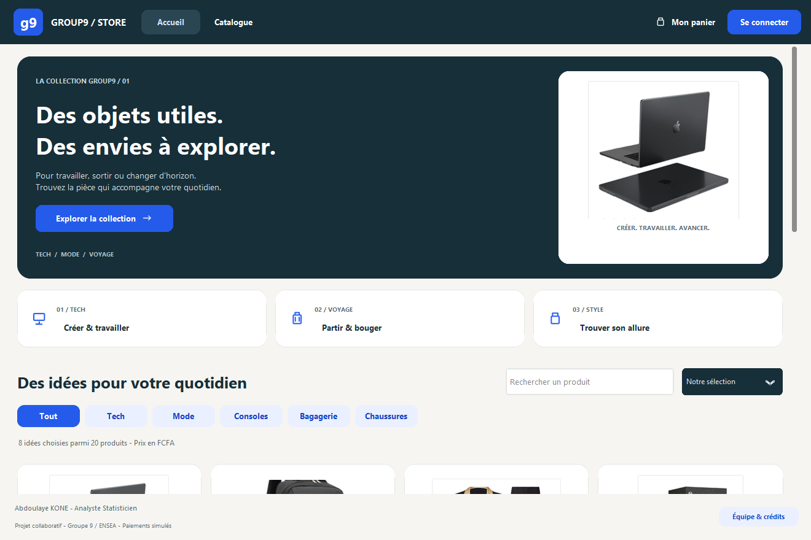
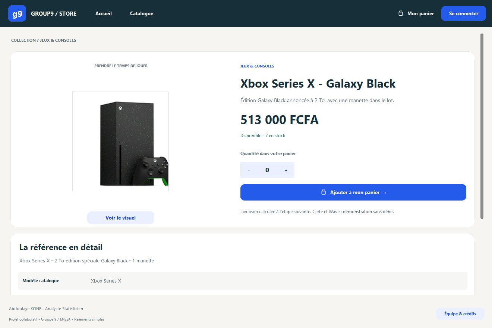
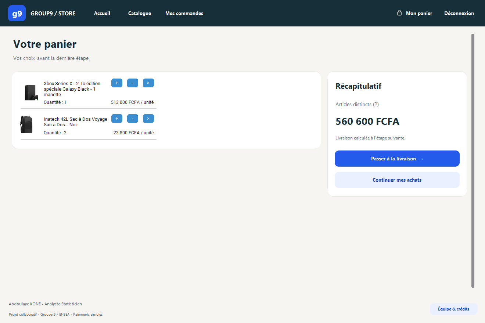
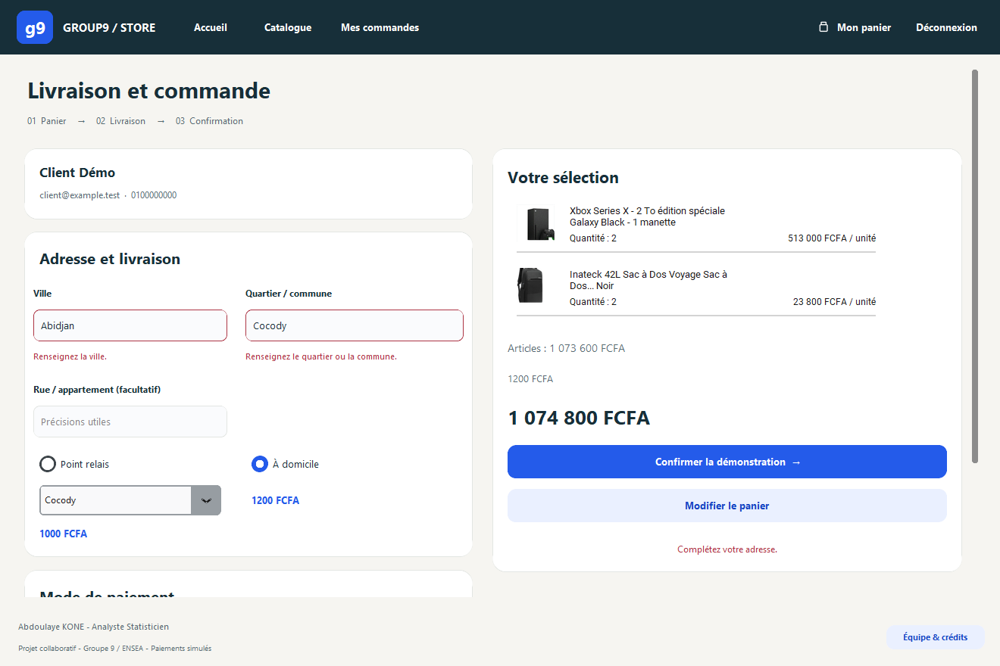
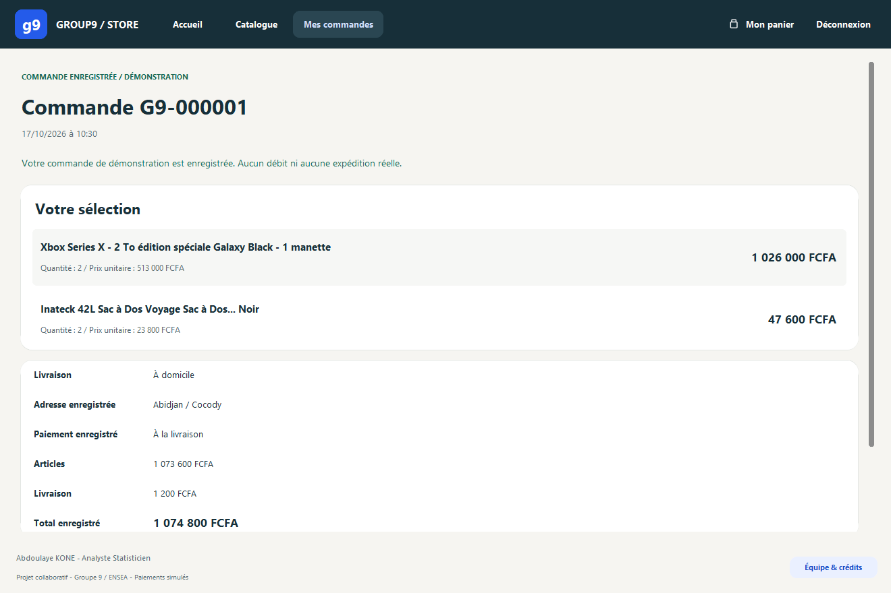
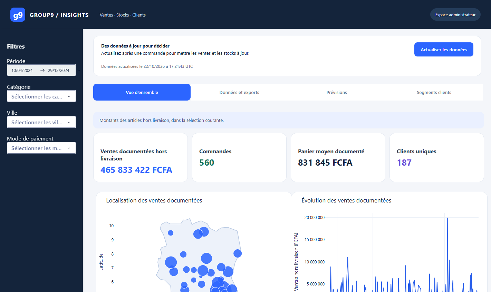
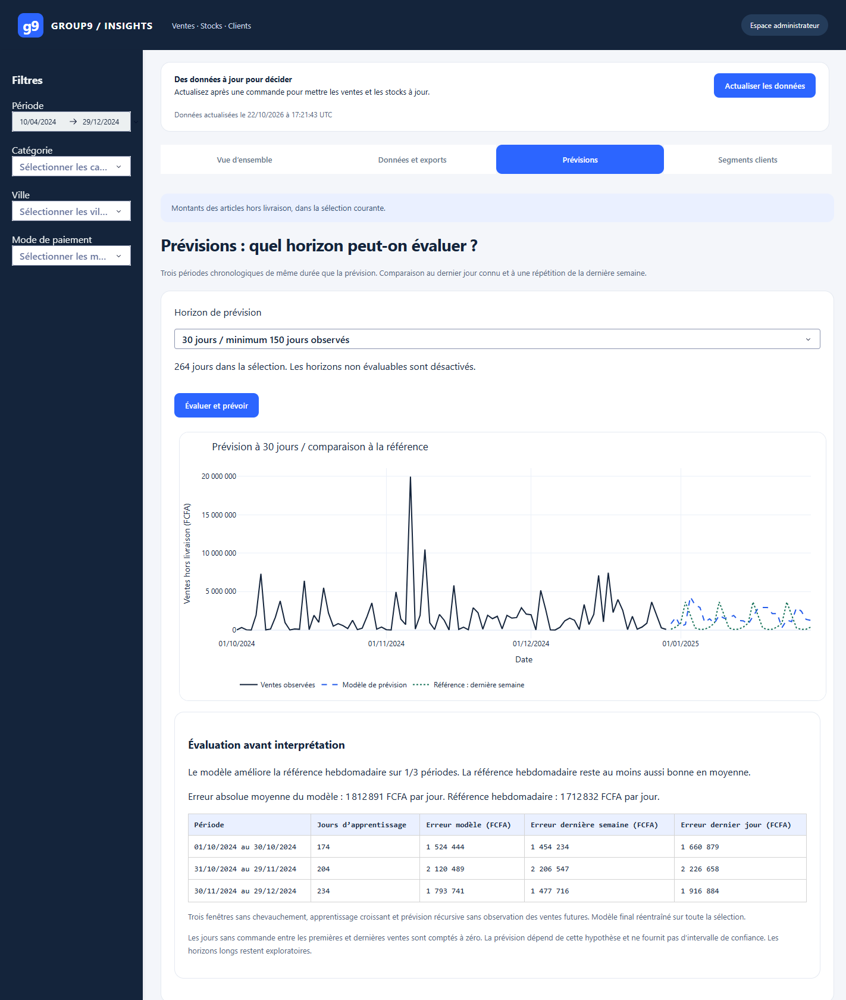

# Boutique Tkinter et tableau de bord Dash

> **In English.** Desktop e-commerce prototype in Python: a Tkinter shop (catalogue, cart, delivery, simulated payment, order history) on MySQL, and a Dash dashboard for sales, stock, exports, XGBoost forecasts and K-means customer segments.
> Orders are confirmed in a single transaction; forecasts are checked on three time-ordered validation windows against naive baselines, and segments are reported with silhouette and stability diagnostics; 125 automated tests.
> ENSEA group project (Python programming course, 2024-2025), later reworked by Abdoulaye KONE.

**Python 3.12 · Tkinter · MySQL · Dash · XGBoost · scikit-learn**

Projet de groupe du cours de programmation Python de l’ENSEA Abidjan, troisième année d’analyste statisticien : concevoir une plateforme de vente en ligne. La boutique et le tableau de bord partagent la même base MySQL : produits, stocks, clients, commandes et paiements.



## Ce que fait l’application

| Boutique | Commande | Analyse |
| :--- | :--- | :--- |
| Catalogue par catégorie, recherche, tri et fiches produit | Panier contrôlé par le stock, livraison en relais ou à domicile, paiement simulé | Ventes, stocks et classements filtrables, export CSV |
| Inscription et connexion, historique personnel des commandes | Stock, lignes, paiement et vidage du panier validés dans une seule transaction | Prévisions XGBoost évaluées, segments clients avec diagnostics |

| Fiche produit | Panier |
| :---: | :---: |
| [](docs/media/produit.png) | [](docs/media/panier.png) |

| Livraison et paiement | Reçu de commande |
| :---: | :---: |
| [](docs/media/commande.png) | [](docs/media/confirmation.png) |

| Tableau de bord | Prévisions |
| :---: | :---: |
| [](docs/media/tableau-de-bord.png) | [](docs/media/previsions.png) |

Les captures de la boutique utilisent des données fictives en mémoire. Celles du tableau de bord ont été prises sur la base de démonstration créée par les générateurs du dépôt.

## Démarrer

Environnement vérifié : **Windows, Python 3.12, MySQL 8.4**. Le [guide d’installation](docs/INSTALLATION.md) détaille la base, le compte MySQL et l’administration.

```powershell
git clone https://github.com/abdoul4Kone/boutique-tkinter-dash.git
cd boutique-tkinter-dash
python -m venv .venv
.venv\Scripts\python -m pip install -r requirements-lock.txt
Copy-Item .env.example .env
```

Renseigner ensuite `.env`, exécuter `database/schema.sql` dans une base vide, puis :

| Ouvrir | Commande |
| :--- | :--- |
| Boutique | `.venv\Scripts\python main.py` |
| Catalogue | `.venv\Scripts\python main.py catalogue` |
| Mes commandes | `.venv\Scripts\python main.py mes-commandes` |
| Tableau de bord | `.venv\Scripts\python main.py tableau-de-bord`, puis `http://127.0.0.1:8050` |
| Données de démonstration | `.venv\Scripts\python main.py generer-clients`, puis `generer-commandes` |

Le tableau de bord demande les identifiants administrateur définis dans `.env` ; aucun identifiant n’est fourni par défaut.

## Données de démonstration

`generer-clients` crée 200 clients fictifs. `generer-commandes` crée 560 commandes réparties au hasard entre avril et décembre 2024, sans toucher au stock actuel de la boutique. Ces ventes n’ont aucune structure à apprendre : sur elles, le modèle de prévision ne fait pas mieux que la simple répétition de la dernière semaine, et l’écran l’indique. Les prévisions et les segments servent ici à montrer une démarche d’évaluation, pas un résultat commercial. Les [méthodes d’analyse](docs/ANALYSES.md) détaillent les fenêtres de validation, les références et les seuils de prudence.

## Ce qui est vérifié

- **125 tests automatisés**, sans serveur MySQL : comptes et sessions, panier, commande atomique, historique, filtres et exports du tableau de bord, prévisions, segmentation et navigation.

  ```powershell
  .venv\Scripts\python -B -m unittest discover -s tests -v
  ```

- **Essai sur une vraie base, le 22 octobre 2026**, avec MySQL Community Server 8.4.11 :
  - chargement du schéma et des deux générateurs ;
  - ouverture de la boutique ;
  - tableau de bord refusé sans identifiants ;
  - prévisions à 7 et 30 jours évaluées, horizon de 90 jours désactivé faute d’historique ;
  - segmentation calculée avec ses diagnostics.
- Un workflow GitHub Actions relance les tests sous Windows à chaque envoi.

## Organisation du code

```text
main.py                     Lanceur unique de toutes les pages
app/
  accounts.py               Comptes, mots de passe et sessions
  commerce.py               Catalogue, panier, livraison et commandes
  analytics.py              Lecture des données, formats français et diagnostics
  config.py, database.py    Configuration et accès MySQL
  navigation.py, runtime.py Routes, fenêtre commune et tâches en arrière-plan
  views/                    Écrans de la boutique
  admin/                    Accès administrateur et tableau de bord Dash
  scripts/                  Générateurs de données de démonstration
assets/                     Photos des produits et contour de la Côte d’Ivoire
database/                   Schéma et migrations explicites
docs/                       Installation, méthodes, captures et rapport d’origine
tests/                      Tests automatisés
```

## Limites

- Les paiements sont simulés : aucun débit ni aucune livraison réelle. L’écran carte ne demande que quatre chiffres fictifs.
- L’application n’a été testée que sous Windows ; elle est prévue pour un usage local, pas pour un déploiement public.
- Les messages d’erreur des écrans Tkinter ne sont pas couverts par les tests automatisés.
- Le composant `DataTable` de Dash est déprécié depuis Dash 4 ; il faudra le remplacer avant une future montée de version.

## Équipe et reprise

Projet du **groupe 9**, ENSEA Abidjan, sous la supervision de **M. KOFFI IPOU** : KONE Abdoulaye (chef d’équipe), KOUADIO Siye Ozias Joël, BOMISSO Abel Moses, NIAMIEN Danielle Esther et YAHYAH NAFIOU Abdoul Magid. Selon le [rapport d’origine](docs/Rapport_projet_Python_final.pdf), le groupe A a conçu les maquettes, l’accueil, le catalogue, la commande et la navigation ; le groupe B la base de données, les comptes, le panier, les commandes et le tableau de bord. Abdoulaye KONE a coordonné le groupe et travaillé au sein du groupe A.

**Reprise individuelle (2026).** Abdoulaye KONE a ensuite repris seul le projet : réorganisation du code autour d’un lanceur unique, sécurisation des comptes et des sessions, commande en une transaction, interface redessinée, évaluation des prévisions et de la segmentation, tests automatisés. L’historique Git conserve la version du groupe.

## Licence

Le code est publié sous [licence MIT](LICENSE). Les photos de produits, reprises de fiches commerciales pour le projet d’origine, restent la propriété de leurs auteurs et ne sont pas couvertes par cette licence. Le contour de la Côte d’Ivoire provient de [Natural Earth](assets/data/NOTICE.md), dans le domaine public.

---

**Abdoulaye KONE - analyste statisticien, diplômé de l’ENSEA Abidjan**
[LinkedIn](https://linkedin.com/in/abdoulaye-kone) · [GitHub](https://github.com/abdoul4Kone)
